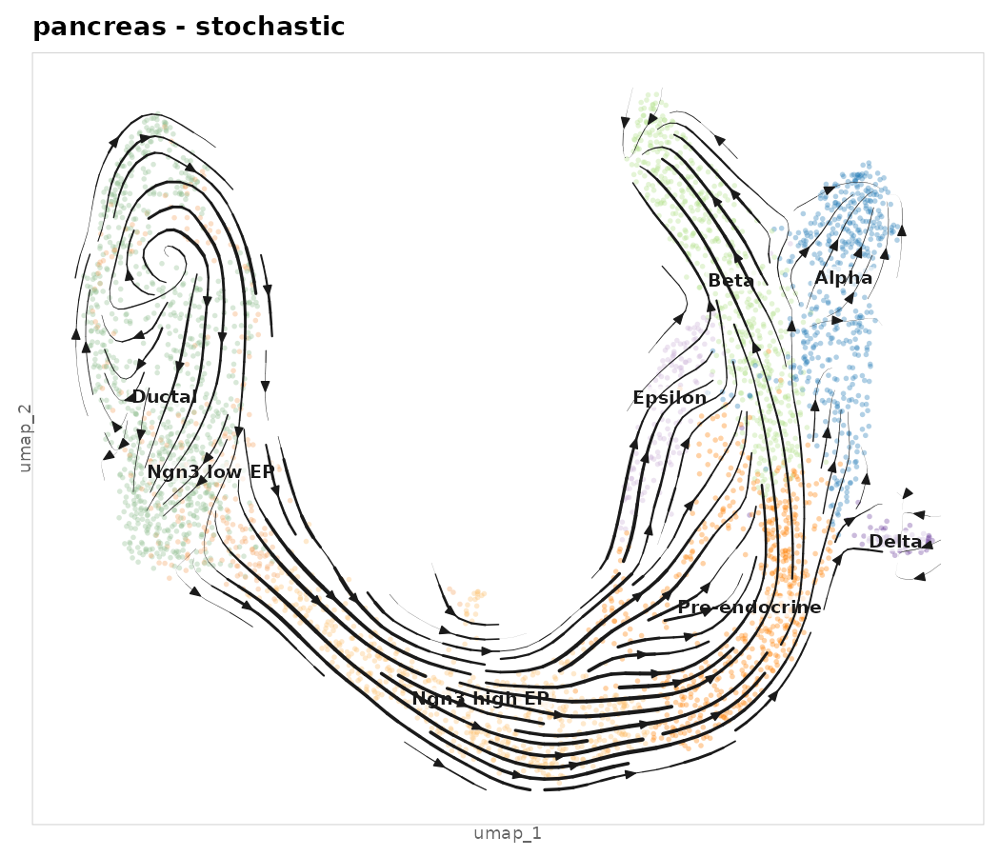
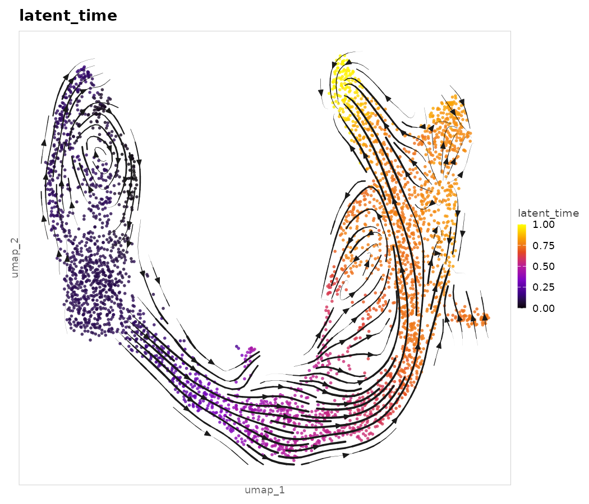
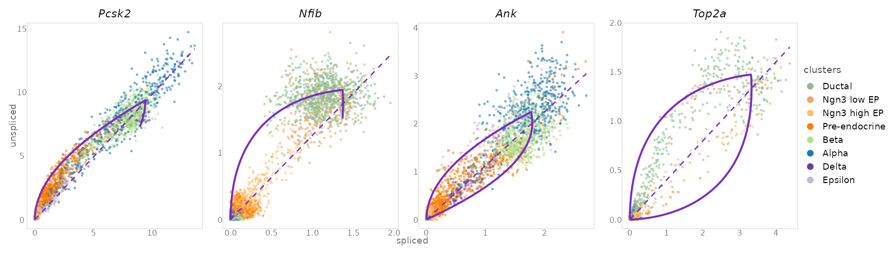
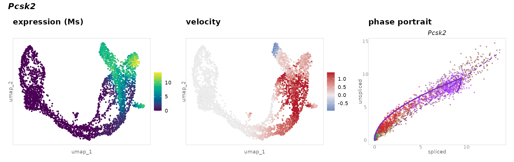
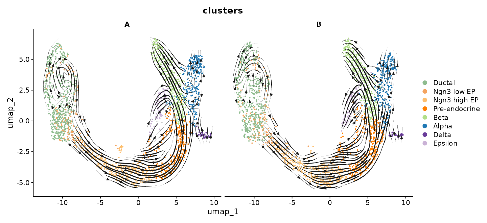

# scVelo2

RNA velocity for single-cell data with a fast Rust core and native R support
(Seurat / SingleCellExperiment). It re-implements the scVelo workflow
(Bergen et al., *Nat. Biotechnol.* 2020) from scratch:

* **one numerical core, several front-ends** — all the maths lives in
  [`velocore`](velocore/) (Rust, multi-threaded, no I/O); the R package
  ([`r-package/`](r-package/)) is a thin layer on top, and a Python package
  can reuse exactly the same core;
* **no Python needed from R** — read velocyto `.loom` files and run everything
  on your Seurat or SingleCellExperiment object;
* **same results as scVelo** — validated step by step against scVelo 0.2.5
  (see [Validation](#validation));
* **faster** — e.g. velocity graph 0.4 s vs 4.2 s, dynamical model 15 s vs 88 s
  on the pancreas data set;
* **ggplot2 figures** — streamlines, grids, arrows, phase portraits with the
  fitted kinetics, latent-time heatmaps, spliced/unspliced proportions.

<p align="center">
  
  
</p>

## Installation (R)

Building from source needs Rust once (`cargo`); users of binary builds
(r-universe, CRAN for Windows/macOS) will not need it.

```bash
curl --proto '=https' --tlsv1.2 -sSf https://sh.rustup.rs | sh
```

```r
# from a clone of this repository
install.packages(c("Matrix", "ggplot2", "RSpectra", "irlba", "patchwork", "uwot"))
BiocManager::install("rhdf5")
devtools::install("r-package", upgrade = FALSE)
```

## Quick start with Seurat

```r
library(scVelo2)
library(Seurat)

loom <- read_loom("velocyto/sample1.loom")   # spliced / unspliced / ambiguous
seu  <- readRDS("my_seurat.rds")              # with a "umap" reduction

# full workflow in one call (cell barcodes are matched automatically)
seu <- run_velocity(seu, loom, mode = "dynamical", reduction = "umap")

plot_velocity_stream(seu, color_by = "seurat_clusters")
plot_velocity_stream(seu, color_by = "latent_time", continuous_palette = "gnuplot")
plot_phase(seu, top_likelihood_genes(seu, 4), color_by = "seurat_clusters")
plot_heatmap(seu, sort_by = "latent_time", group_by = "seurat_clusters")
plot_velocity_gene(seu, "Pcsk2")
plot_proportions(seu, group_by = "seurat_clusters")
rank_velocity_genes(seu, group_by = "seurat_clusters")
```

Or step by step, as in scVelo:

```r
seu <- add_velocity_data(seu, loom)
seu <- velocity_filter_normalize(seu, min_shared_counts = 20, n_top_genes = 2000)
seu <- velocity_moments(seu, n_neighbors = 30, n_pcs = 30)  # uses Seurat's PCA if present
seu <- velocity(seu, mode = "stochastic")                    # or "deterministic", "dynamical"
seu <- velocity_graph(seu)
seu <- velocity_embedding(seu, reduction = "umap")
seu <- velocity_confidence(seu)
seu <- terminal_states(seu)
seu <- velocity_pseudotime(seu)
seu <- latent_time(seu)                                      # dynamical model only
```

Results are stored inside the object (`seu@misc$scVelo2`, accessible with
`get_velo(seu)`); per-cell results (`latent_time`, `velocity_pseudotime`,
`velocity_confidence`, `root_cells`, `end_points`, ...) are added to the
Seurat metadata. Several samples: `read_loom(c("s1.loom", "s2.loom"),
sample_names = c("s1", "s2"))`. The number of threads is controlled with
`options(scVelo2.threads = 8)` (default: all cores).

For a SingleCellExperiment use the same functions (results go to
`metadata(sce)$scVelo2` and `colData(sce)`); without any object,
`add_velocity_data(NULL, loom)` gives a stand-alone analysis.

<p align="center">
  
</p>
<p align="center">
  
</p>

### Input files: loom or h5ad

Counts can come from velocyto `.loom` files or from AnnData `.h5ad` files
(scVelo / scanpy, any anndata version, read without Python). `.h5ad` files
also bring their `obs` metadata and `obsm` embeddings (e.g. `X_umap`).

```r
seu <- run_velocity(seu, "velocyto/sample1.loom")
seu <- run_velocity(seu, "adata_with_spliced_unspliced.h5ad")
dat <- read_velocity_data(c("s1.loom", "s2.h5ad"), sample_names = c("s1", "s2"))
```

### Seurat-style plots

`VelocityDimPlot()` and `VelocityFeaturePlot()` are Seurat's `DimPlot()` /
`FeaturePlot()` with the velocity field on top: every Seurat argument works
(`group.by`, `split.by`, `label`, `cols`, `alpha`, `order`, `ncol`, ...), and
with `split.by` the flow is computed separately in each panel.
`add_velocity()` adds the flow to any plot you already have.

```r
VelocityDimPlot(seu, group.by = "seurat_clusters", label = TRUE)
VelocityDimPlot(seu, split.by = "sample", velocity = "grid")          # "stream", "grid", "arrows"
VelocityFeaturePlot(seu, c("latent_time", "Pcsk2"), split.by = "sample",
                    velocity.args = list(density = 1.5))
DimPlot(seu, group.by = "celltype") |> add_velocity(seu, type = "arrows")
```

### One analysis per sample

With `split_by` every step runs independently on each sample (own genes,
neighbours, kinetic fits, velocity graph, latent time); per-cell results are
recombined on the shared embedding and the plots are split by sample
automatically. The functions are the same as for a joint analysis:

```r
seu <- run_velocity(seu, loom, mode = "dynamical", split_by = "sample")
# or step by step: add_velocity_data(seu, loom, split_by = "sample") then the usual steps
VelocityDimPlot(seu, group.by = "seurat_clusters")      # one panel per sample
plot_phase(seu, c("Pcsk2", "Cpe"))                       # rows = samples
plot_heatmap(seu, sample = "s1")                         # per-sample views
get_sample_velo(seu, "s1")                               # the full result of one sample
```

Use a joint analysis when samples are replicates of the same process, and a
per-sample one when they differ in condition, batch or chemistry and you do
not want one sample's kinetics to shape another's.

<p align="center">
  
</p>

## Validation

`validation/reference_scvelo.py` runs scVelo 0.2.5 on the pancreas
endocrinogenesis data and exports every intermediate result;
`velocore/examples/validate.rs` and `validation/r_pancreas.R` compare them with
scVelo2 on the same inputs (same genes, same neighbour graph):

| step | agreement with scVelo |
|---|---|
| gene filtering, normalisation, HVG selection | identical genes, max abs. diff 9e-5 (float32) |
| first-order moments `Ms`, `Mu` | rel. error 1e-7 |
| stochastic model: γ, R², velocity genes, velocities | rel. error ≤ 2e-5, same 1038 velocity genes |
| velocity graph | same 678 365 edges, rel. error 1e-6 |
| embedding projection (incl. arrow autoscale) | rel. error 6e-7 |
| stream / grid velocities | rel. error 2e-7, same masked grid points |
| velocity confidence (both scores) | rel. error ≤ 2e-6 |
| velocity pseudotime | correlation 1.0000 |
| dynamical model (vs scVelo on float64 moments) | correlation ≥ 0.99999, 917/1038 genes identical |
| latent time | Pearson 0.989 |

A note on the dynamical model: scVelo fits it on **float32** moments, and its
EM is very sensitive to rounding — scVelo on float32 vs scVelo on float64
moments agree only to correlation 0.976 (γ) / 0.944 (switching time). scVelo2
works in float64 and matches scVelo-on-float64 almost exactly.

While validating we also hit two crashes of scVelo 0.2.5 with current numpy
(`velocity_graph` with `n_jobs > 1` and `align_dynamics`); see the workarounds
in `validation/reference_scvelo.py`.

## Timing (pancreas, 3 696 cells × 2 000 genes, 16 threads)

| step | scVelo 0.2.5 | scVelo2 |
|---|---|---|
| neighbours + moments | 4.9 s | 0.2 s |
| velocity graph | 4.2 s | 0.4 s |
| recover dynamics (1038 genes) | 88 s (8 jobs) | 15 s |

## Known issues

* On simulated data (`simulate_splicing()`), `latent_time()` correlates only
  ~0.73 (Spearman) with the true time, while the median fitted gene time
  reaches 0.90: root cells are detected mid-trajectory. On the pancreas data
  latent time agrees with scVelo (Pearson 0.989). Under investigation.

## Layout

```
velocore/          Rust core (pure numerics, unit tests, validation examples)
r-package/         R package scVelo2 (extendr bindings + R API + ggplot2)
validation/        reference scripts and comparisons against scVelo
```

## Roadmap

* Python package on the same core (PyO3, AnnData) with matplotlib/plotnine figures
* binary builds (r-universe / PyPI wheels) so that users never need Rust
* approximate neighbours for very large data sets, differential kinetics,
  uncertainty of velocities

## Credits and license

scVelo2 re-implements methods of [scVelo](https://github.com/theislab/scvelo)
(Bergen, Lange, Peidli, Wolf & Theis, 2020) and velocyto (La Manno et al.,
2018); please cite them. BSD 3-Clause license (see `LICENSE`).
